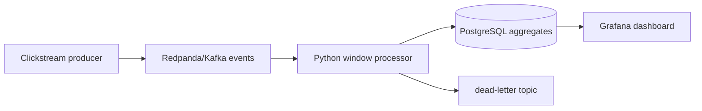

# Project 3 - Real-Time Streaming

## Architecture



Events are keyed by `event_id`. The processor maintains five-minute tumbling
windows, accepts late events for up to two minutes using an event-time
watermark, and writes aggregates with an idempotency key
`(window_start, event_type)`. Invalid JSON or missing fields goes to the DLQ.
The sink uses `ON CONFLICT DO UPDATE`, so retries do not duplicate results.

## Run locally

```bash
docker compose up --build
python producer/producer.py --count 100
python processor/processor.py
```

Redpanda Console is available at `http://localhost:8080`; Grafana is at
`http://localhost:3000` (admin/admin). The implementation uses Kafka-compatible
APIs so it can be swapped for managed Kafka.
